# ตั้งแต่สร้างบอทจนได้ไฟล์ (ภาพรวมทั้งระบบ)

ภาพเดียวครอบคลุม 4 ช่วง (บวกการติดตั้งตัวอัด ดู 12-agent.md)
1. สร้างบอทและตั้งค่าครั้งเดียว
2. deploy service ขึ้น k8s และวิธีที่ service ต่อกับ Discord
3. การอัดเสียง
4. การอัดหน้าจอบน k8s ผ่านเบราว์เซอร์หรือตัวอัด (agent) ของคนที่แชร์ โดยต้องมีคนกด 🔴 ก่อน

```mermaid
flowchart TD
  %% ================= 1. สร้างบอท (ทำครั้งเดียว) =================
  subgraph S1["① สร้างบอท — ทำครั้งเดียว"]
    direction TB
    P1[Discord Developer Portal<br/>New Application] --> P2[แท็บ Bot: Reset Token<br/>ได้ DISCORD_TOKEN<br/>ปิด Public Bot]
    P2 --> P3[แท็บ OAuth2: เลือก scope<br/>bot + applications.commands<br/>สิทธิ์: View/Send/Attach, Connect, Speak]
    P3 --> P4[เปิดลิงก์เชิญ แล้วเลือก server<br/>บอทเข้ามาอยู่ใน server]
    G1[Google Cloud: สร้าง OAuth client<br/>npm run drive-auth<br/>ได้ GOOGLE_REFRESH_TOKEN] --> G2[(โฟลเดอร์ Drive กลาง<br/>DRIVE_FOLDER_ID)]
  end

  %% ================= 2. deploy =================
  subgraph S2["② Deploy ขึ้น Kubernetes"]
    direction TB
    K1["<b>docker build</b> จาก Dockerfile<br/>• base: node:24-bookworm-slim<br/>• apt install ffmpeg<br/>• npm ci --omit=dev<br/>• copy แค่ package*.json + src/<br/>• รันเป็น user node, EXPOSE 8080<br/>→ docker push REGISTRY/discord-recorder:tag"]
    K1 --> K0["<b>Namespace</b> discord-recorder"]
    K0 --> K2["<b>Secret</b> (ไฟล์ k8s/secret.yaml — ห้าม commit)<br/>• DISCORD_TOKEN — token บอท<br/>• GOOGLE_CLIENT_SECRET<br/>• GOOGLE_REFRESH_TOKEN<br/>kubectl apply -f k8s/secret.yaml"]
    K2 --> K3["<b>ConfigMap</b> (ค่าไม่ลับ ใน deployment.yaml)<br/>• CLIENT_ID — Application ID ของบอท<br/>• GOOGLE_CLIENT_ID, DRIVE_FOLDER_ID<br/>• ALLOWED_GUILD_IDS / ALLOWED_USER_IDS — จำกัด server/คน<br/>• SCREEN_ENABLED=false — ปิดอัดจอแบบ Mac<br/>• PUBLIC_URL=https://recorder.xxx.com — เปิดอัดจอผ่านเบราว์เซอร์<br/>• HTTP_PORT=8080<br/>• CAPTURE_MAX_MB=3072 ต่อครั้ง, CAPTURE_TOTAL_MB=8192 รวมทั้งเครื่อง<br/>• SHARE_CARDS — ค่าเริ่มต้นของการ์ดแชร์จอ (AUTO_SCREEN ชื่อเดิม)<br/>• AGENTS_FILE, AGENT_CODE_PAIRING — ที่เก็บ credential ตัวอัด / เปิดปิดรหัส 6 หลัก<br/>• HTTP_MAX_CONNECTIONS — จำนวน connection สูงสุด (ตัวอัดออนไลน์ค้าง 1 connection ต่อเครื่อง)<br/>• DELETE_AFTER_UPLOAD=true — ขึ้น Drive แล้วลบไฟล์ใน pod"]
    K3 --> K4["<b>Deployment</b><br/>• replicas: 1 + strategy Recreate (2 ตัว = ตอบคำสั่งซ้ำ)<br/>• env จาก Secret + ConfigMap<br/>• CPU 100m–1, RAM 256Mi–1Gi<br/>• volume recordings: emptyDir 20Gi (ไฟล์ระหว่างอัด)<br/>• volume data: PVC discord-recorder-data 1Gi<br/>  เก็บ settings.json และ agents.json (credential ตัวอัด เป็น hash)<br/>• probe GET /healthz :8080"]
    K4 --> K5["<b>Service</b> ClusterIP<br/>port 80 → pod 8080"]
    K5 --> K6["<b>Ingress</b> (k8s/ingress.yaml, nginx)<br/>• host recorder.xxx.com + TLS (cert-manager)<br/>• เปิดแค่ /capture /static /api/capture /agent /api/agent<br/>• body ≤ 20MB ต่อชิ้น, ไม่ buffer, timeout 120s (รองรับ long-poll 25s ของตัวอัด)<br/>• จำกัด 10 req/วินาที ต่อ IP<br/>• /healthz ไม่เปิดออกนอก"]
  end

  P4 --> K1
  G2 -.ใช้ตอนส่งไฟล์.-> D3

  %% ================= service ต่อกับ Discord =================
  subgraph S3["③ Service ต่อกับ Discord ยังไง"]
    direction TB
    C1[pod เริ่มทำงาน: npm start] --> C2[ลงทะเบียน slash command<br/>/record /screen /panel /settings /agent]
    C2 --> C3[เปิด WebSocket ออกไปหา Discord Gateway แล้วค้างไว้<br/>ใช้ขาออกอย่างเดียว ไม่ต้องมี Ingress]
    C3 --> C4{{Discord ส่งเหตุการณ์มาทางเส้นนี้}}
    C4 -->|คนพิมพ์ /record หรือกดปุ่ม| C5[interactionCreate<br/>ตรวจสิทธิ์ แล้วทำงาน]
    C4 -->|คนเข้าออกห้อง หรือเริ่มหยุดแชร์จอ| C6[voiceStateUpdate<br/>checkShares โพสต์หรือลบการ์ด 🔴 ไม่เริ่มอัดเอง]
    C5 --> C7[ตอบกลับผ่าน Discord REST API<br/>ข้อความ + ปุ่ม และแก้ข้อความเดิมได้]
    C6 --> C7
  end

  K4 --> C1

  %% ================= 4. อัดเสียง =================
  subgraph S4["④ อัดเสียง — บอททำเองทั้งหมด"]
    direction TB
    V1[บอทเข้าห้องเสียงเหมือนเป็นสมาชิก<br/>🔴 บนการ์ด: เตรียมอัด ยังไม่รับเสียง<br/>จนภาพจอแรกขึ้น แล้วจึงเริ่มนับเวลาเสียง] --> V2[Discord ส่งเสียงของแต่ละคนแยกกันให้บอท]
    V2 --> V3[เก็บไฟล์ละคน แล้วเติมช่วงเงียบให้ตรงเวลากัน]
    V3 --> V4[ตอนหยุด ffmpeg รวมเป็น voice.mp3]
  end

  C5 -->|🎙️ อัดเสียง หรือ 🔴 บนการ์ด| V1

  %% ================= 5. อัดจอบน k8s =================
  subgraph S5["⑤ อัดหน้าจอบน k8s — ภาพมาจากเครื่องของคนที่แชร์ (ตัวอัดหรือเบราว์เซอร์)"]
    direction TB
    W0[["❌ Discord ไม่ส่งภาพแชร์จอให้บอท<br/>และ pod ไม่มีหน้าจอ<br/>→ ต้องให้เครื่องของคนที่แชร์ส่งภาพมาเอง"]]
    W1["บอทโพสต์การ์ด 🔴 ให้ห้องที่มีคนแชร์ ยังไม่อัดอะไร<br/>มีคนกด 🔴: ถ้าคนแชร์มีตัวอัดออนไลน์ บอทสั่งตัวอัด (W9)<br/>ไม่มี: ปุ่มลิงก์บนการ์ด<br/>กดเอง: 🖥️ อัดจอ สั่งตัวอัดของตัวเอง (ไม่มีตัวอัด หรือ 🌐: ลิงก์ที่เห็นคนเดียว)"] --> W2[คนที่แชร์กดลิงก์<br/>ได้หน้าอัดจอที่เปิดได้ครั้งเดียว<br/>ข้อเสนอกดเองหมดใน 5 นาที]
    W2 --> W3[เปิด https://recorder.xxx.com/capture/token ในเบราว์เซอร์<br/>ผ่าน Ingress เข้า pod]
    W9[💻 ตัวอัดบนเครื่องผู้ใช้<br/>ติดตั้งด้วย /agent หนึ่งบรรทัด Node + ffmpeg ของตัวเอง ตรวจ SHA-256<br/>poll หา /api/agent/poll ทุก 25 วินาที ไม่มีโทเคน Discord<br/>เมื่อถูกสั่ง start ส่งชิ้นวิดีโอผ่าน chunk API เดียวกับเบราว์เซอร์] --> W6
    W1 -.->|คนแชร์มีตัวอัด| W9
    W3 -.->|มือถือ อัดจอไม่ได้| W8[📱 หน้าเว็บบอกให้ใช้คอมพิวเตอร์<br/>หรือกด 🎙️ ถ้าจะอัดแค่เสียง<br/>บอทไม่อัดอะไรแทน]
    W3 --> W4[Chrome ถามว่าจะอัดจอไหน<br/>getDisplayMedia + MediaRecorder]
    W4 --> W5[ส่งภาพเป็นชิ้นทุก 3 วินาที<br/>PUT /api/capture/.../chunk/N]
    W5 --> W6[pod เก็บชิ้นลงดิสก์<br/>emptyDir recordings]
    W6 --> W7[ตอนหยุด ffmpeg ต่อชิ้นเป็น screen.mp4<br/>ไม่ encode ใหม่ CPU ไม่หนัก]
  end

  C6 -->|มีคนแชร์จอ และเปิดการ์ดแชร์จอ| W1
  K6 -.HTTPS.-> W3

  %% ================= 6. ส่งผล =================
  subgraph S6["⑥ ส่งผล"]
    direction TB
    D1{"หยุดเมื่อไหร่<br/>กด ⏹️ / ไม่มีคนแชร์เหลือ (รอ 2 นาทีถ้ายังมีคนแชร์) /<br/>ออกจากห้อง / ครบเวลาสูงสุด / แท็บหรือตัวอัดหลุด"} --> D2
    D2["<b>รวมไฟล์เสียงและวิดีโอ</b> — ทำใน pod ด้วย ffmpeg<br/><br/>📁 /app/recordings/ &nbsp;<i>(emptyDir 20Gi — หายเมื่อ pod restart)</i><br/>├─ 📁 &lt;guildId&gt;-2026-11-05T10-00-00-000Z/ &nbsp;<i>← อัดเสียง</i><br/>│ &nbsp; ├─ 📄 &lt;userIdA&gt;.pcm &nbsp;เสียงดิบคน A ≈11.5MB/นาที<br/>│ &nbsp; ├─ 📄 &lt;userIdB&gt;.pcm &nbsp;เสียงดิบคน B<br/>│ &nbsp; └─ 🎵 <b>voice.mp3</b> &nbsp;← amix รวมทุกคน<br/>└─ 📁 &lt;guildId&gt;-2026-11-05T10-00-00-000Z-2/ &nbsp;<i>← อัดจอ (คู่กัน)</i><br/>&nbsp; &nbsp; &nbsp;├─ 📁 chunks/ &nbsp;000000.bin (หัวไฟล์) 000001.bin … ชิ้นละ ~3 วิ<br/>&nbsp; &nbsp; &nbsp;└─ 🎬 <b>screen.mp4</b> / .webm &nbsp;← ต่อชิ้น (ไม่ encode ใหม่) แล้วลบ chunks/<br/>&nbsp; &nbsp; &nbsp; &nbsp; &nbsp; &nbsp;แปลงไม่ได้ → screen-raw.* ส่งไฟล์ดิบแทน<br/>&nbsp; &nbsp; &nbsp;└─ 🎬 <b>screen-with-audio.mp4</b> / .webm &nbsp;← ภาพ + เสียงในห้อง (ขั้นถัดไป)"]
    D2 --> DM{มีวิดีโอ และมี voice.mp3 คู่กันไหม}
    DM -->|มี| DC["<b>🎞️ รวมเป็น meeting.mp4 ไฟล์เดียว</b> (src/compose.js)<br/>• segment เดียว ครอบคลุมเสียงเกือบทั้งหมด → ทางลัด ไม่ encode ใหม่<br/>• หลาย segment → encode ใหม่บน canvas เดียว ช่วงว่างเป็นภาพดำ เสียงห้องต่อเนื่อง<br/>• ทีละงาน (คิว), nice, timeout · ล้มเหลว → ส่งแยกไฟล์ + ⚠️"]
    DM -->|"มี แบบเดิม Mac หรือลิงก์ส่วนตัว"| DA["<b>🔊 ใส่เสียงเข้าวิดีโอ</b> (src/merge.js, ffmpeg)<br/>• เลื่อนเสียง = เวลาเริ่มภาพ − เวลาเริ่มอัดเสียง ให้ตรงกัน<br/>• ภาพ copy ไม่ encode ใหม่ · เสียงเป็น AAC (mp4) / Opus (webm)<br/>• คนแชร์ติ๊กแชร์เสียง → amix ผสมเสียงเครื่องเขากับเสียงห้อง<br/>• พลาด → ส่งวิดีโอเงียบ + ⚠️ รวมเสียงเข้าวิดีโอไม่สำเร็จ"]
    DM -->|"ไม่มีภาพเลย (session)"| DN[⚪ ไม่ได้อัด — ไม่มีภาพจอ<br/>ไม่มีไฟล์ ไม่อัป บอทออกจากห้อง]
    DM -->|"🎙️ อัดเสียงอย่างเดียว"| D3
    DA --> D3[อัปขึ้น Google Drive]
    DC --> D3
    D3 --> D4[แก้ข้อความเดิมใน Discord เป็น ✅<br/>อัดจอ: ▶️ ดูวิดีโอ = meeting.* ไฟล์เดียว<br/>อัดเสียงอย่างเดียว: 🎧 ฟังเสียง = voice.mp3<br/>แท็บหน้าอัดจอเด้งไปเปิดวิดีโอใน Drive]
    D4 --> D5["<b>ลบไฟล์ใน pod</b> (DELETE_AFTER_UPLOAD=true)<br/>ลบทั้งโฟลเดอร์ของการอัดนั้น เมื่อขึ้น Drive ครบทุกไฟล์<br/>อัปพลาดสักไฟล์ → เก็บโฟลเดอร์ไว้ (เอาออกได้ด้วย kubectl cp)"]
  end

  V4 --> D1
  W7 --> D1

  classDef once fill:#f3e5f5,stroke:#6a1b9a,color:#4a148c
  classDef k8s fill:#e3f2fd,stroke:#1565c0,color:#0d47a1
  classDef rec fill:#ffebee,stroke:#c62828,color:#b71c1c
  classDef out fill:#e8f5e9,stroke:#2e7d32,color:#1b5e20
  classDef warn fill:#fffde7,stroke:#f9a825,color:#5d4037
  class P1,P2,P3,P4,G1,G2 once
  class K0,K1,K2,K3,K4,K5,K6,C1,C2,C3,C4,C5,C6,C7 k8s
  class V1,V2,V3,V4,W1,W2,W3,W4,W5,W6,W7,W8,W9 rec
  class D1,D2,DM,DA,DC,D3,D4,D5 out
  class W0 warn
  style D2 text-align:left
```

## สรุปสั้น
- **บอทกับ Discord:** pod เปิดการเชื่อมต่อออกไปหา Discord เอง ส่วนนี้จึงไม่ต้องมีโดเมนหรือ Ingress
- **อัดเสียง:** Discord ส่งเสียงให้บอทได้ บอทจึงอัดเองได้ทั้งหมด
- **ไม่กด ไม่อัด:** มีคนแชร์จอ บอทแค่โพสต์การ์ด 🔴 เข้าห้องและอัดเมื่อมีคนกดเท่านั้น
- **อัดจอ:** Discord ไม่ส่งภาพให้บอท ภาพจึงมาจากเครื่องของคนที่แชร์ ผ่านตัวอัด (agent, ติดตั้งด้วย `/agent`) หรือเบราว์เซอร์ ซึ่งส่งเข้า pod ผ่าน Ingress และ HTTPS ส่วนนี้ต้องมีโดเมน ถ้าคนแชร์เปิดลิงก์จากมือถือ บอทจะอัดได้แค่เสียงในห้อง
- **หนึ่ง session ต่อ server:** เสียงห้องอัดต่อเนื่อง ภาพเป็นหลาย segment (🔁 สลับคนแชร์ได้) แล้วรวมเป็น `meeting.mp4` ไฟล์เดียว
- **วิดีโอมีเสียง:** ตอนจบ บอทเอา `voice.mp3` (เสียงทุกคนในห้อง) ใส่เข้าไปในวิดีโอของคนแชร์ โดยเลื่อนเวลาให้ตรงกัน ได้ `meeting.*` ที่ปุ่ม ▶️ ดูวิดีโอ (หลาย segment จะ encode ใหม่รวมกัน)
- **ไฟล์ระหว่างอัด:** อยู่ที่ `/app/recordings/<guildId>-<เวลา>/` ใน pod หนึ่งโฟลเดอร์ต่อการอัดหนึ่งครั้ง อัปขึ้น Drive ครบแล้วจะลบออก ถ้า pod restart ก่อนอัปเสร็จ ไฟล์จะหาย
  ดูไฟล์ใน pod ได้ด้วย `kubectl -n discord-recorder exec deploy/discord-recorder -- ls -laR /app/recordings`
- **ตัวอัด:** `/agent` ให้คำสั่งบรรทัดเดียวที่ติดตั้ง Node + ffmpeg ที่ pin hash ไว้ลง `~/.discord-recorder-agent` ไม่มีไฟล์ใหญ่ใน image ของบอท credential เก็บฝั่งบอทเป็น hash ใน `data/agents.json` (PVC)
- **pod เดียว:** ทำทั้งงานบอทและเว็บเซิร์ฟเวอร์ และต้องคง `replicas: 1` ไว้ ถ้ามีสองตัว บอทจะตอบคำสั่งซ้ำสองครั้ง
