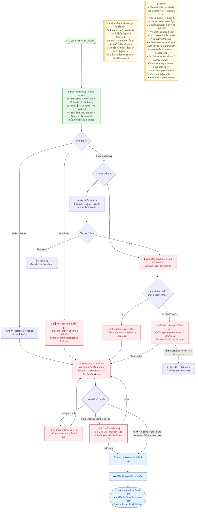

# บอทอัดประชุมทำงานยังไง (สำหรับทุกคน)

ภาพเดียวจบ ไม่ต้องรู้เรื่องเทคนิค หลักคือ **ไม่มีใครกด ก็ไม่อัด** ยกเว้นผู้ดูแลตั้ง **⚡ อัดอัตโนมัติ** ไว้: มีคนแชร์จอก็อัดเลย พอเริ่ม บอทเข้าห้องรอทันที แต่**เริ่มอัดเมื่อภาพจอขึ้นเท่านั้น** (อัดเสียงอย่างเดียวได้จาก 🎙️ อัดเสียง เท่านั้น)

