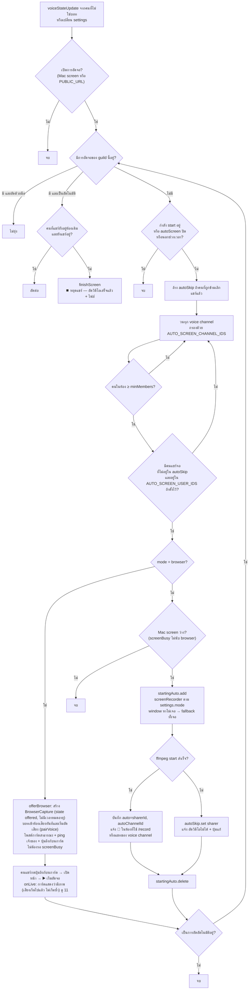

# 6. Flow อัดอัตโนมัติเมื่อมีคนแชร์จอ

> โหมด browser: ข้อเสนออัตโนมัติไม่หมดเวลา (เสียงอัดตั้งแต่แชร์จนกว่าการแชร์จะจบ) จึงไม่มี `autoSkip` จากการไม่กด การอัดที่จบเอง (heartbeat ขาด, ไฟล์เต็ม, ปิดหน้า) จะใส่คนแชร์ลง `autoSkip` เพื่อไม่เสนอซ้ำจนกว่าเขาจะเลิกแชร์ และ guild มีการอัดแบบ browser ได้ครั้งละ 1 (คนแชร์คนถัดไปได้ข้อเสนอเมื่อช่องว่าง)
