# 6. Flow เมื่อมีคนแชร์จอ (ส่งการ์ด / อัดอัตโนมัติ)

ตั้งค่า `shareMode` ต่อ server: **ปิด** ไม่ทำอะไร · **ส่งการ์ด** ไม่กด = ไม่อัด บอทแค่โพสต์การ์ด 🔴 ไม่เข้าห้อง ไม่สั่งตัวอัด · **อัดอัตโนมัติ** (แบบเดิม) มีคนแชร์จอก็อัดเลยเหมือนเจ้าตัวกด 🔴: บอทเข้าห้องทันที (เตรียมอัด) ภาพจากตัวอัดของเขา ไม่มีตัวอัด = ปุ่ม 🎥 ลิงก์บนการ์ด (บอทที่ไม่มี PUBLIC_URL อัดจอ Mac)

ทุกการเริ่ม (กด 🔴 หรืออัตโนมัติ) ใช้ `launch`: บอทเข้าห้องพร้อมกับสั่งภาพ ไม่รอกัน แต่**ยังไม่อัดอะไรจนภาพแรกขึ้น** (`startAudio`: เสียงห้องเริ่มที่เวลาเดียวกับภาพ) ช่วงเตรียมอัดไม่มีเวลาหมด จบก่อนมีภาพ = ⚪ ไม่ได้อัด ไม่มีไฟล์ (อัดเสียงอย่างเดียวได้จาก 🎙️ เท่านั้น) ตั้ง "อัดจอด้วย" (`mode`) เป็น `agent` = สั่งตัวอัดถ้าออนไลน์ ไม่งั้นลิงก์ · `browser` = ลิงก์เสมอ ไม่สั่งตัวอัด

```mermaid
flowchart TD
    EV["voiceStateUpdate จากคนที่ไม่ใช่บอท<br/>เปลี่ยน settings, sweep ทุก 1 นาที<br/>หรือตัวอัดของใครออนไลน์"] --> EN{"เปิดการอัดจอ?<br/>(Mac screen หรือ PUBLIC_URL)"}
    EN -->|"ไม่"| X0["จบ"]
    EN -->|"ใช่"| CH["checkShares: วนทุก voice channel ที่เฝ้า<br/>กรองด้วย AUTO_SCREEN_CHANNEL_IDS"]
    CH --> ON{"shareMode ไม่ใช่ปิด<br/>อยู่ในช่วงเวลา และคน ≥ minMembers?"}
    ON -->|"ไม่"| DEL["ลบการ์ดของห้องนี้ ถ้ามี"]
    ON -->|"ใช่"| SH{"มีคนแชร์ที่ผ่านตัวกรอง<br/>(role, minShareSeconds, ไม่อยู่ใน cardSkip,<br/>ไม่ใช่ segment ของ session ที่กำลังอัด)?"}
    SH -->|"ไม่"| DEL
    SH -->|"ใช่"| AU{"อัดอัตโนมัติ + guild ไม่มีการอัดอื่น<br/>+ บอทเข้าห้องได้ (+ จอ Mac ว่าง ถ้าใช้ Mac)?"}
    AU -->|"ใช่ (คนที่มีตัวอัดก่อน ไม่งั้นคนแรก)"| AS["autoStart: newSession by = คนแชร์ (sess.auto)<br/>การ์ดห้อง (ถ้ามี) กลายเป็นการ์ดของ session"]
    AS --> LA
    AU -->|"ไม่ (ส่งการ์ด หรืออีกห้องกำลังอัด)"| RC["การ์ดห้องเดียวต่อห้อง รายชื่อคนแชร์<br/>ปุ่ม 🔴 ต่อคน (ไม่เกิน 3) + ping ครั้งเดียว<br/>ข้อความ: ยังไม่ได้อัดอะไร"]
    RC --> PR{"มีคนกด 🔴 screen:rec:uid?<br/>(canRecord หรือเป็นเจ้าของปุ่มเอง)"}
    PR -->|"ไม่กด"| RC
    PR -->|"กด"| BZ{"guild นี้มีการอัดอยู่?"}
    BZ -->|"มี ห้องเดียวกัน"| B1["ephemeral: กำลังอัดอยู่แล้ว"]
    BZ -->|"มี ห้องอื่น"| B2["ephemeral: อัดได้ทีละห้องต่อ server"]
    BZ -->|"ไม่มี"| NS["newSession: จอง screen ทันที (starting)<br/>การ์ดห้องกลายเป็นการ์ดของ session"]
    NS --> LA["launch: พร้อมกัน<br/>• joinSession บอทเข้าห้องทันที แต่ยังไม่อัด (hold)<br/>• startScreen ภาพของคนแชร์<br/>การ์ด: ⏳ เตรียมอัดในห้อง … ⏳ กำลังสั่งเครื่องของ X<br/>ชื่อบอท: … - ⏳ เตรียมอัด"]
    LA --> SRC{"แหล่งภาพ"}
    SRC -->|"mode agent + ตัวอัดออนไลน์"| AG["สั่งตัวอัด start (มี area) รอ ack 15 วิ<br/>ไม่มีการถาม ดู 12"]
    SRC -->|"ไม่มีตัวอัด หรือ mode browser"| LK["ปุ่ม 🎥 ลิงก์ของคนแชร์บนการ์ด<br/>⏳ เตรียมอัดในห้อง … · กด 🎥 เพื่อเริ่มอัด<br/>เปิดครั้งเดียว ดู 11"]
    SRC -->|"ไม่มี PUBLIC_URL"| MC["จอ Mac ของบอท ถ้า screenBusy ว่าง<br/>ไม่ว่าง/พลาด: ⚪ ไม่ได้อัด พร้อมหมายเหตุ"]
    AG -->|"ok"| LV
    AG -->|"ไม่ว่าง / ไม่ตอบ / ffmpeg / ออฟไลน์<br/>(ตัวอัดรุ่นเก่าปฏิเสธ)"| FB["หมายเหตุ ⚠️ บนการ์ด ยังเตรียมอัด<br/>อัตโนมัติ: ข้ามคนนี้ ไม่สั่งตัวอัดซ้ำ<br/>แล้วใช้ลิงก์แทน (ถ้ายังแชร์อยู่)"]
    FB --> LK
    LK -->|"เปิดลิงก์และแชร์จอ"| LV
    LK -->|"ไม่เปิด แล้วเลิกแชร์ / ออก / ✖️ / ทุกคนออก / ครบเวลา"| NR["⚪ ไม่ได้อัด — ไม่มีภาพจอ<br/>ไม่ compose ไม่อัป บอทออกจากห้อง"]
    MC --> LV
    LA -->|"บอทเข้าห้องไม่ได้"| JF{"มีภาพอัดอยู่หรือกำลังสั่งตัวอัด?"}
    JF -->|"มี"| JN["อัดภาพต่อ หมายเหตุ เข้าห้องไม่ได้ อัดแค่ภาพจอ"]
    JF -->|"ไม่มี (แค่ลิงก์ที่ยังไม่เปิด)"| CN["ยกเลิก ⚪ ไม่ได้อัด ไม่ส่งไฟล์<br/>ข้ามคนแชร์จนกว่าจะแชร์ใหม่"]
    LV["live: startAudio เสียงห้องเริ่มอัด (startedAt = เวลาภาพขึ้น)<br/>🔁 บนการ์ด ถ้ามีคนอื่นแชร์เพิ่ม (ไม่สลับเองแม้อัดอัตโนมัติ)<br/>อัตโนมัติ + ลิงก์ยังไม่เปิด + ตัวอัดของเขาออนไลน์ = สลับไปตัวอัด 1 ครั้ง<br/>จบตาม state machine ใน 12.3"]
    LV -->|"คนที่ถูกอัดเลิกแชร์ / ตัวอัดหลุด / กด s"| WT{"อัดอัตโนมัติ และมีคนแชร์อื่น?"}
    WT -->|"ใช่"| NX["autoNext: อัดจอคนนั้นต่อทันที (ตัวอัดก่อน ไม่งั้นลิงก์)<br/>session และไฟล์เดิม ไม่รอ 2 นาที"]
    NX --> LV
    WT -->|"ไม่"| W2["รอ 2 นาทีให้กด 🔴 ต่อ ตามเดิม<br/>ไม่มีใครแชร์เหลือ = จบทันที"]
```

> `cardSkip` จะถูกเพิ่มเมื่อคนแชร์กดหยุดที่ตัวอัด/หน้าเว็บ การเริ่มถูกยกเลิก ตัวอัดเริ่มไม่สำเร็จในโหมดอัตโนมัติ หรือ session จบ (ทุกคนที่แชร์อยู่ตอนนั้น) และล้างเมื่อเขาเลิกแชร์ จึงไม่โผล่การ์ดหรือเริ่มซ้ำทันที
> ตั้งค่า (ปิดการ์ด ช่วงเวลา ห้อง) มีผลกับการ์ดและการเริ่มอัดอัตโนมัติเท่านั้น session ที่เริ่มแล้วไม่ถูกตัดกลางคัน เหมือนการอัดเอง
> อัดอัตโนมัติ: กด ⏹️ = ทุกคนที่แชร์อยู่ถูกข้ามจนกว่าจะแชร์ใหม่, กด `s` ที่ตัวอัด = คนนั้นถูกข้าม (ถ้ามีคนอื่นแชร์อยู่ ต่อที่คนนั้น) เครื่องที่หลุด/เกินขนาดจะไม่ถูกเริ่มซ้ำเอง ต้องกด 🔴 ต่อ ชื่อบอทเป็น `<ชื่อ> - 🔴 อัดจออัตโนมัติ` และ log ลงท้าย `(อัตโนมัติ)` ลิงก์บนการ์ดไม่หมดใน 5 นาที (ใช้ได้ maxMinutes หรือ 24 ชม. เปิดได้ครั้งเดียว)
> อีกห้องที่แชร์ระหว่างมี session ได้การ์ด ไม่เริ่มเอง เมื่อ session แรกจบ ถ้าเขายังแชร์อยู่ จะเริ่มอัตโนมัติตอนนั้น
> การ์ดห้องที่ค้างตอนบอทรีสตาร์ทจะถูกลบ แล้ว checkShares โพสต์ใหม่ให้คนที่ยังแชร์อยู่ (โหมดอัตโนมัติ: เริ่มอัดให้)
