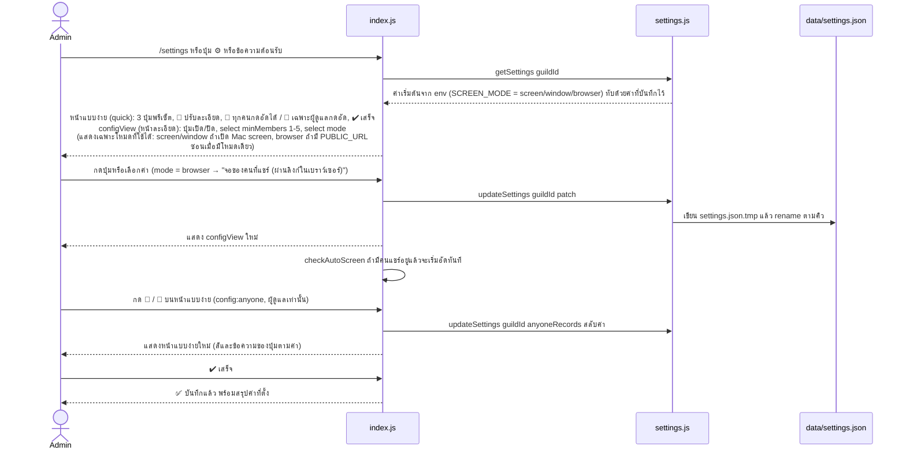

# 7. การตั้งค่าราย server

> ค่า mode ที่บันทึกไว้แต่ใช้ไม่ได้แล้ว (เช่น window บน k8s) จะถูกใช้เป็นโหมดแรกที่มีอยู่แทน (`modeOf`) และสรุปค่าแสดงโหมดที่ใช้จริง
> 👥 ทุกคนกดอัดได้ (`anyoneRecords`, ค่าเริ่มต้นปิด) ให้ทุกคนกด 🎙️ 🎥 ⏹️ ได้ แต่ไม่ได้เปลี่ยนสิทธิ์ตั้งค่า ปุ่มนี้ซ่อนเมื่อตั้ง `ALLOWED_USER_IDS` (รายชื่อนั้นแทนสิทธิ์ทั้งหมด)
