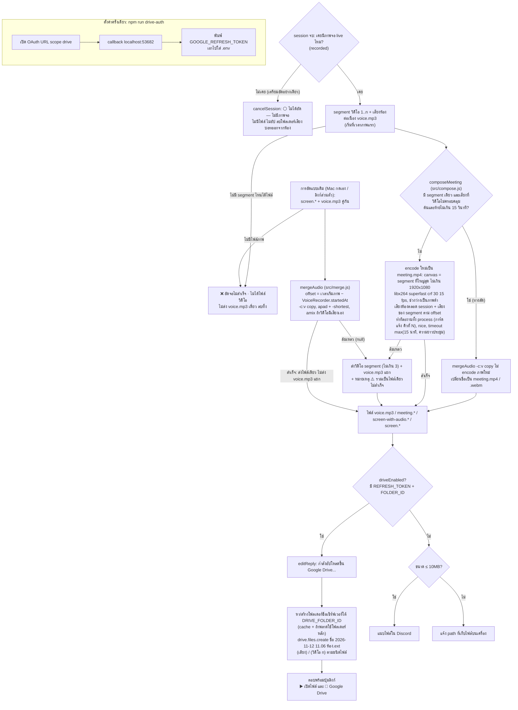

# 8. การส่งไฟล์ (deliver)

> session หนึ่งครั้งส่ง `meeting.*` ไฟล์เดียวเป็นปุ่ม ▶️ ดูวิดีโอ (ใช้เป็นปลายทางที่หน้าอัดจอเด้งไปเปิดด้วย) ถ้า session ไม่เคยมีภาพเลย (เตรียมอัดแล้วจบ) จะไม่มีไฟล์และไม่อัปอะไร voice.mp3 ส่งเดี่ยวได้เฉพาะ 🎙️ อัดเสียง การลบโฟลเดอร์ (`DELETE_AFTER_UPLOAD`) ทำเมื่ออัปครบทุกไฟล์และไม่มี segment ของ session ที่ยังใช้โฟลเดอร์อยู่
