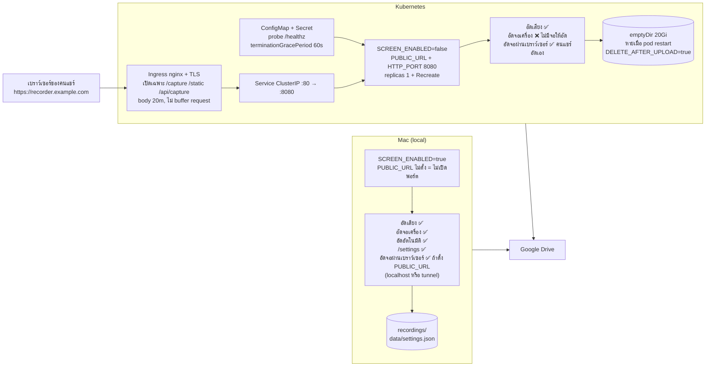

# 10. Deploy 2 แบบ

> โค้ดยังไม่ได้จัดการ `SIGTERM` ถ้า pod ถูก restart ระหว่างอัด ไฟล์ที่อัดอยู่จะหายไปกับ `emptyDir` และลิงก์อัดจอที่ออกไปแล้วใช้ไม่ได้ (key ของลิงก์สุ่มใหม่ทุกครั้งที่ process เริ่ม) ถึงจะตั้ง grace period ไว้ 60 วินาทีก็ไม่ช่วย
