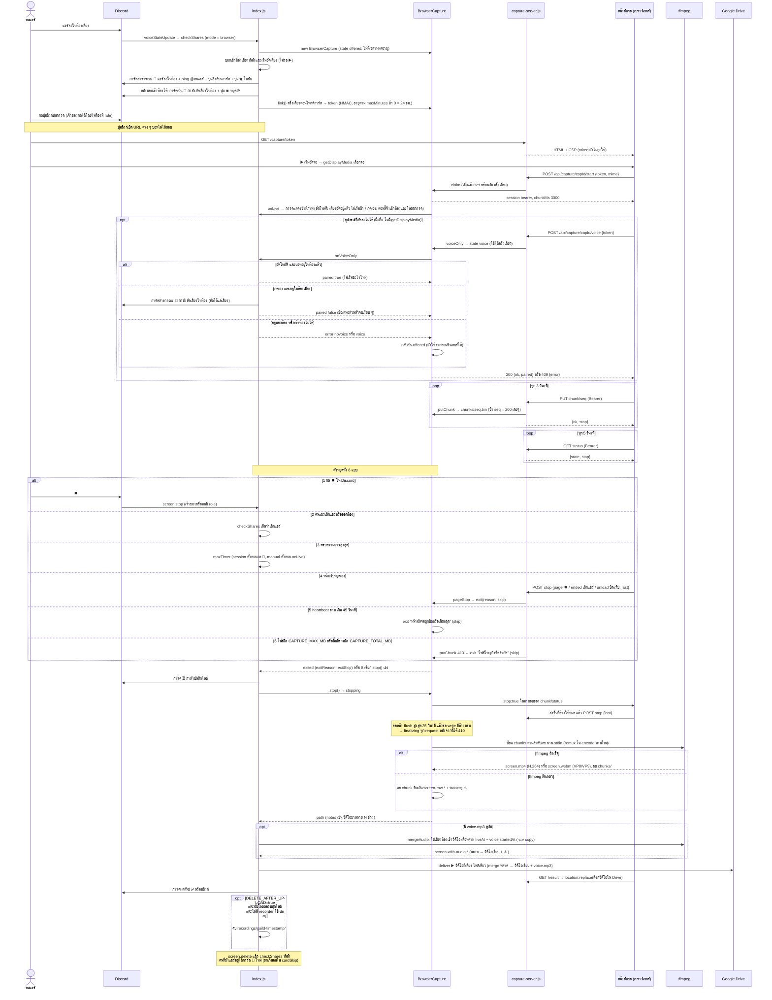
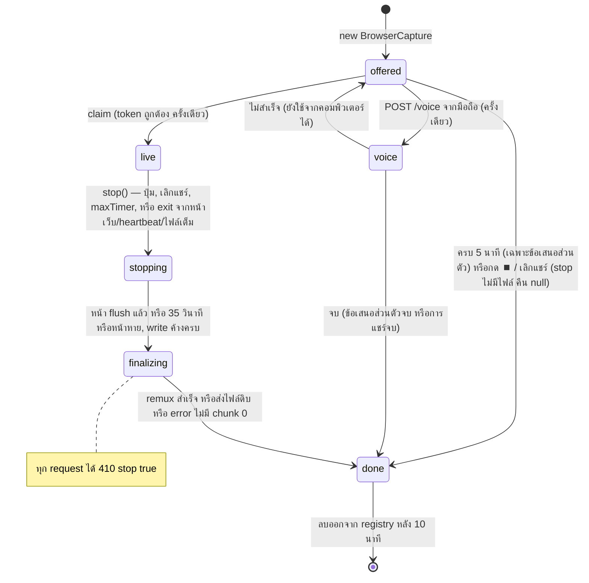

# 11. อัดจอผ่านเบราว์เซอร์ (BrowserCapture)

คนแชร์อัดจอตัวเองในเบราว์เซอร์ แล้วส่งชิ้นวิดีโอให้บอททาง HTTP (`capture-server.js`) ใช้ได้เมื่อตั้ง `PUBLIC_URL`

## ลำดับเหตุการณ์

ลิงก์บนการ์ดของ session (กด 🔴 หรืออัดอัตโนมัติ, ไม่มีตัวอัดหรือตั้งอัดจอด้วยเบราว์เซอร์) ไม่มีเวลาหมดอายุ บอทเข้าห้องและอัดเสียง **ทันทีที่ session เริ่ม** (โหมดส่งการ์ด: หลังมีคนกด 🔴) ลิงก์มี `?area=discord` เมื่อตั้งกรอบอัดเป็นแค่หน้าต่าง Discord หน้าเว็บจะบอกให้เลือกหน้าต่าง Discord การอัดจบตาม state machine ใน 12.3 (คนแชร์เลิกแชร์ ⏹️ ครบเวลาสูงสุด หรือหน้าอัดจอจบเอง) ถ้าหน้าจบเอง (ปิดแท็บ heartbeat ขาด ไฟล์เต็ม) คนแชร์จะอยู่ใน `cardSkip` จนกว่าจะเลิกแชร์ ถ้าไม่มีใครเปิดลิงก์ เสียงในห้องก็ยังอัดอยู่ ข้อเสนอส่วนตัวของ 🌐 อัดผ่านเบราว์เซอร์ หมดเวลาใน 5 นาที ตัวอัด (agent) ใช้ chunk API เดียวกันนี้ ดู 12

## สถานะของ BrowserCapture

