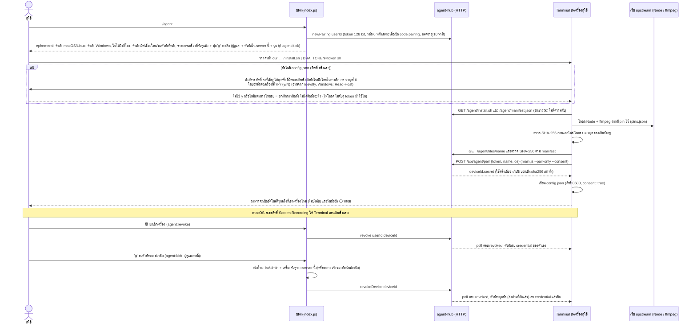
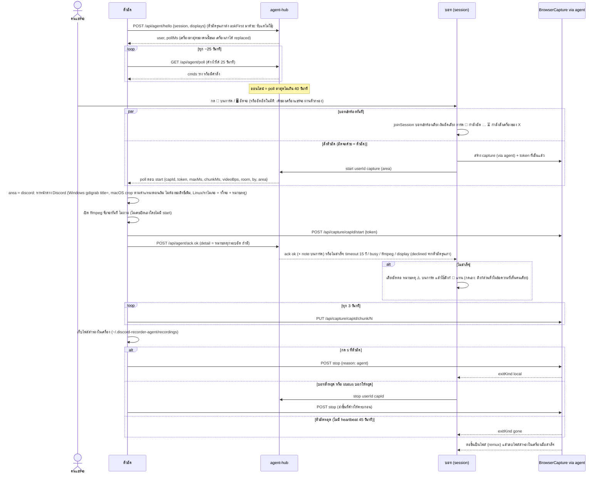
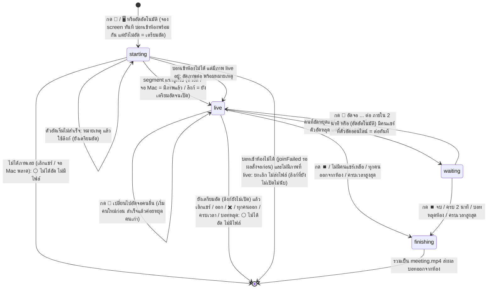

# 12. ตัวอัด (agent) และ session

ตัวอัดคือโปรแกรมเล็กๆ บนเครื่องของคนแชร์จอ บอทสั่งให้อัดเมื่อมีคนกด 🔴, เจ้าของเครื่องกด 🖥️ อัดจอ หรือ server ตั้ง ⚡ อัดอัตโนมัติ แล้วเจ้าของเครื่องแชร์จอใน Discord (ตัวอัดเองไม่เคยเริ่มเอง ต้องมีคำสั่ง start จากบอทเสมอ) ไม่มีโทเคน Discord อยู่ในตัวอัด เจ้าของเครื่องตกลงครั้งเดียวตอนติดตั้ง ตอนอัดไม่ถามอีก

## 12.1 ติดตั้งและจับคู่ (ครั้งเดียวต่อเครื่อง)

> รันซ้ำคำสั่งเก่าได้ จะเป็นการอัปเดต (มี config อยู่แล้ว = ไม่ถามซ้ำ, token ที่ใช้แล้ว = ข้ามการจับคู่) เครื่องที่ติดตั้งไว้ก่อนมีคำถามนี้ถือว่าตกลงแล้ว ค่า askFirst เก่าใน config ถูกลบตอนเปิดตัวอัดครั้งถัดไป `npm run agent` ครั้งแรกถามคำถามเดียวกันในเทอร์มินัล (หรือใส่ `--consent`) นักพัฒนาใช้ `npm run agent -- --server URL --code 123456` แทนได้ ส่วนผู้ดูแลใช้ `npm run build:agent` เพื่อรีเฟรช hash ที่ pin ไว้

## 12.2 long-poll และการอัดหนึ่งครั้ง

## 12.3 สถานะของ session (หนึ่งต่อหนึ่ง server)

> อัดอัตโนมัติ: segment ที่บอทเริ่มเองมี `seg.auto` (การ์ดขึ้น ⚡ อัดอัตโนมัติ ชื่อบอท `<ชื่อ> - 🔴 อัดจออัตโนมัติ` log ลงท้าย `(อัตโนมัติ)`) ไม่สลับเองระหว่าง live (🔁 ยังต้องกด) เมื่อคนที่อัดหยุด waiting จะเรียก `autoNext` ทันที (ตัวอัดก่อน ไม่งั้นลิงก์) เครื่องที่หลุด/เกินขนาดอยู่ใน `sess.noAuto` (ต้องกด 🔴 ต่อ) ถ้าตัวอัดเริ่มไม่สำเร็จ คนนั้นเข้า `cardSkip` (ไม่สั่งตัวอัดซ้ำ) แต่ session ใช้ลิงก์ของเขาต่อ ตัวอัดรุ่นเก่าไม่รู้จัก `area` และอัดทั้งจอ บอทไม่รู้ว่าเป็นรุ่นเก่า
> **เตรียมอัด**: ตั้งแต่เริ่มจนภาพแรก live (`recorded(sess)`) บอทอยู่ในห้องแต่ไม่อัดอะไร (การ์ด/ชื่อบอท `⏳ เตรียมอัด`) ไม่มีเวลาหมดของตัวเอง ภาพแรกขึ้น (ตัวอัด claim, เปิดลิงก์, จอ Mac) → `startAudio` เสียงเริ่มที่ `videoAt` จบก่อนมีภาพ = `cancelSession` ไม่มีไฟล์ (อัดเสียงอย่างเดียวได้จาก 🎙️ เท่านั้น) หลังมีภาพแล้ว เสียงในห้องอัดต่อเนื่องตลอด session แม้ช่วง waiting ส่วน session แบบกดเอง (🖥️ อัดจอ ที่มีตัวอัด) ไม่มี 🔁 และไม่มี waiting จบทันทีเมื่อกด ⏹️ คนกดออกจากห้อง หรือตัวอัดหลุด
